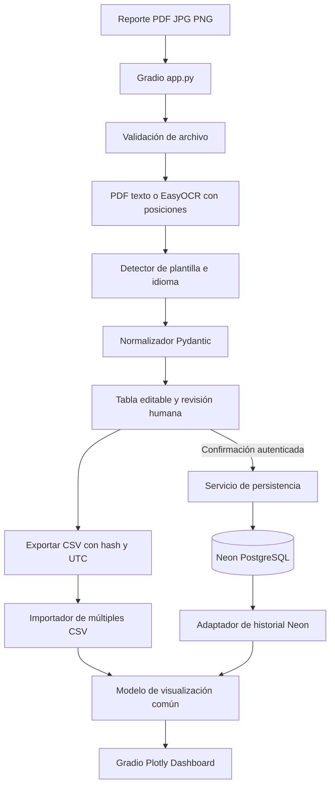

# 02 — Arquitectura técnica y flujos de datos

## Arquitectura ejecutable de main, 2026-11-03

```text
Browser /privacy (3 permisos) -> auth Gradio 6 / OAuth por operación
  -> app.py sidebar Proyecto | InBody | FitNotes | Chat
  -> InBody PDF/imagen -> PyMuPDF/Pillow -> Gemini Flash -> Pydantic
     -> tabla + visor -> reviewed -> guardar una vez -> Neon auditoría
  -> CSV FitNotes -> Python/Pandas -> sets por owner_key -> Neon
  -> dashboard InBody -> SQL autorizado -> Pandas/Plotly
  -> chat -> acceso privado InBody + FitNotes -> contexto acotado
     -> prompt específico -> Gemini Flash -> burbujas de sesión
GitHub Actions -> tests/harness -> deploy allowlist -> Hugging Face Space
```

`inbody_mvp/coach_data.py` resuelve identidad InBody privada sin ID
visible y aplica owner_key a FitNotes; eso **no** equivale a RLS
multitenant. `inbody_mvp/prompt_loader.py` carga prompts externos
versionados. La migración 009 de metadatos ya existe en Neon, mientras
`semantic_metadata.py` está en PR #84 pendiente de integrar.

El diagrama de OCR determinista, exportación CSV v1 y dashboard
CSV+Neon que aparece debajo es **arquitectura legacy**, no flujo activo.
Mapa exhaustivo de archivos en [11](11_cobertura_codigo_main.md).


---


> **Arquitectura vigente (2026-11-03):** [diagrama actualizado](00_estado_vigente_y_trazabilidad.md#2-arquitectura-y-tecnologías-reales). UI Gradio 6 en Hugging Face Spaces; `app.py` orquesta módulo Proyecto, InBody Gemini Flash (google-genai + PyMuPDF/Pillow + Pydantic), revisión y auditoría privada PostgreSQL/Neon (SQLAlchemy+psycopg), FitNotes CSV → Training Hub y chat Gemini sobre resúmenes autorizados. Los tres consentimientos se recogen en `/privacy` **antes** del login; el desplegable Gemini de InBody es independiente del chat. `spaces` se mantiene por compatibilidad con ZeroGPU, no para ejecutar Gemini localmente. EasyOCR/PaddleOCR y CSV multiarchivo corresponden a soporte **legacy o plan**, no al runtime principal. Los diagramas de OCR/CSV posteriores son HISTÓRICOS; no utilizarlos para reproducir sin contraste.


## Estado vigente — 1 de noviembre de 2026 (PR #38, pendiente de validación E2E)

La interfaz activa de **InBody Hub** es Gradio y usa **Gemini Flash** mediante
`inbody_mvp/gemini_review.py` para extraer el examen actual de PDF/JPG/PNG.
El envío a Google exige consentimiento separado por documento. No se capturan
gráficos de historial. El encabezado (fecha/hora, archivo, ID y edad) se repite
en cada fila; `section`, `measurement`, `value`, `unit` forman el contrato
de mediciones. El nombre de la medición incluye el segmento corporal cuando
corresponde. Frecuencia es una medición por fila, y Puntaje InBody también.

La tabla permite revisar cada fila y corregir sección, nombre, valor y unidad.
Se conservan el valor original de Gemini, indicador calculado de corrección,
comentario obligatorio al corregir y estado revisado. Los decimales se
preservan como texto (ej. `8.20`). El guardado en Neon es una **auditoría privada**
separada de las tablas de historial y requiere OAuth, consentimiento y
`migrations/004_gemini_measurement_audit.sql`. No está comprobado el
despliegue E2E ni ejecutada esa migración.

**Componentes retirados del runtime/despliegue:** visor y editor de secciones,
EasyOCR, PaddleOCR y ZeroGPU. Los módulos y pruebas de OCR heredados permanecen
en el repositorio como material legacy; no se distribuyen en el Space. La
demostración anónima y el CSV antiguo no son parte del flujo activo de carga,
aunque subsisten módulos de compatibilidad y el dashboard público/historial.
No confundir documentación histórica del MVP con su estado operativo actual.


## 1. Stack obligatorio del MVP

- **Frontend/servidor web:** Gradio `Blocks`, pestañas y componentes `File`, `Dataframe`, `Plot` y controles de sesión.
- **Visualizaciones:** Plotly (líneas interactivas); Pandas para preparación.
- **Extracción:** PyMuPDF para texto nativo PDF, EasyOCR para imágenes y páginas escaneadas; OCR con coordenadas `detail=1`. ZeroGPU según elegibilidad del Space.
- **Modelo/validación:** Python 3.12 como referencia en CI, Pydantic v2.
- **BD:** PostgreSQL 17 en Neon, acceso con SQLAlchemy 2 y psycopg 3. Alembic para evoluciones controladas.
- **Hosting:** Hugging Face Spaces `sdk: gradio`, `app_file: app.py`. GitHub Actions sincroniza los archivos necesarios.
- **Autenticación:** OAuth de Hugging Face; autorización de lado servidor y privilegios mínimos de BD.
- **Pruebas:** pytest con fixtures sintéticos; no depende de una base real ni de pesos OCR descargados para pruebas unitarias.

**No utilizar Dash, Flask o React como interfaz del MVP.** No sustituir Gradio por Docker sin justificación y aprobación.

## 2. Diagrama lógico



**Aclaración:** la dirección de conexión SQL es del backend de Gradio hacia Neon, tanto para lectura como escritura. Neon no necesita llamar a Hugging Face. El CSV es una alternativa autónoma, no un reemplazo de la BD.

## 3. Mapeo a archivos existentes

| Archivo actual | Responsabilidad |
| --- | --- |
| `app.py` | Punto de entrada, UI Gradio, eventos y control de acceso de operaciones |
| `inbody_mvp/extractor.py` | Validar archivo, extraer PDF/imagen, producir candidatos Pydantic |
| `inbody_mvp/layouts.py` | Detector/parser espacial para plantilla conocida InBody 580 |
| `inbody_mvp/layouts_es.py` | Parser de plantilla española con siluetas y frecuencias |
| `inbody_mvp/language.py` | Determinar idioma ES/EN/UNKNOWN conservadoramente |
| `inbody_mvp/review.py` | Tabla editable, validación y contrato CSV v1 |
| `inbody_mvp/storage.py` | Autorización, escritura transaccional, lectura Neon |
| `db/schema.sql` | DDL versionado del esquema inicial |
| `tests/` | Casos unitarios sintéticos y regresiones |
| `.github/workflows/deploy-huggingface.yml` | Sincronización del Space |
| `.github/workflows/test-inbody.yml` | Pruebas en PR |

**Ampliaciones recomendadas:** `inbody_mvp/dashboard.py` para adaptadores Neon/CSV y gráficos; `inbody_mvp/exports.py` para nombres y contratos de archivo. Estas rutas son propuesta, no parte de la implementación verificada de `main` al redactar.

## 4. Flujo de carga y extracción

1. Subida Gradio (temporal) → comprobación firma, límites y tipo.
2. PDF de texto: PyMuPDF antes de OCR; PDF escaneado/imagen: EasyOCR. Conservar cajas y confianza por bloque donde estén disponibles.
3. Selección de parser según evidencia del modelo/plantilla. Si la plantilla no encaja, parser genérico conservador.
4. Detección de idioma del reporte por encabezados. Si evidencia insuficiente, `UNKNOWN`.
5. Modelo candidato: metadatos, lista de medidas, advertencias y procedencia por página.
6. Tabla editable con validaciones: el usuario confirma valores y metadatos o los deja sin resolver.
7. Exportación CSV independiente o guardado autorizado en Neon.
8. No borrar una evaluación existente automáticamente al reimportar.

## 5. Flujo del dashboard y separación de responsabilidades

- **Ruta Neon:** OAuth válido → autorización → consulta SQL parametrizada y acotada → adaptador de datos → filtros → Plotly.
- **Ruta CSV:** archivos CSV seleccionados → validación de contrato/UTF-8/tamaño → unión de filas → descarte de duplicados idénticos → filtros → Plotly. **Prohibido** escribir a Neon en esta ruta.
- Mantener `source_type`, etiqueta original, modelo, frecuencia y origen cuando existan. El CSV v1 tiene menos campos que Neon; no completar metadatos inexistentes mediante suposiciones.
- No compartir un `DataFrame` global entre usuarios; aislar estado por sesión y limitar el tiempo de retención de archivos temporales.

## 6. Persistencia e idempotencia

Una transacción escribe persona, examen y todas sus mediciones, o no escribe nada. `source_sha256` de documento único impide guardar dos veces el mismo archivo. No equiparar dos documentos distintos solo porque coincidan fecha/peso; informar potencial duplicado. No asumir que IDs de diferentes establecimientos son globales y únicos; documentar `source_namespace` y futura conciliación.

La exportación genera un nombre distinto **cada vez que se exporta**: hash de contenido + UTC de alta resolución; dos exportaciones iguales pueden tener el mismo hash, pero timestamp diferente. Si se desea identidad de archivo estrictamente criptográfica, añadir un sufijo aleatorio o escritura exclusiva para evitar carreras.

## 7. Decisiones de reconstrucción

- **Monolito modular** de Python para bajo volumen, sin microservicios prematuros.
- PostgreSQL sirve historial confirmado; CSV sirve movilidad, recuperación y análisis sin dependencia de servicio.
- No construir pipeline hacia Databricks hasta que haya un caso analítico y controles de privacidad.
- No cargar imágenes identificables en Hugging Face Space público. El entorno que maneje datos reales debe ser privado, autenticado y auditado.
- Las dependencias se reproducen por `requirements.txt`; en una reconstrucción, fijar un archivo de bloqueo probado para estabilidad y revalidar compatibilidades de GPU/Gradio.
